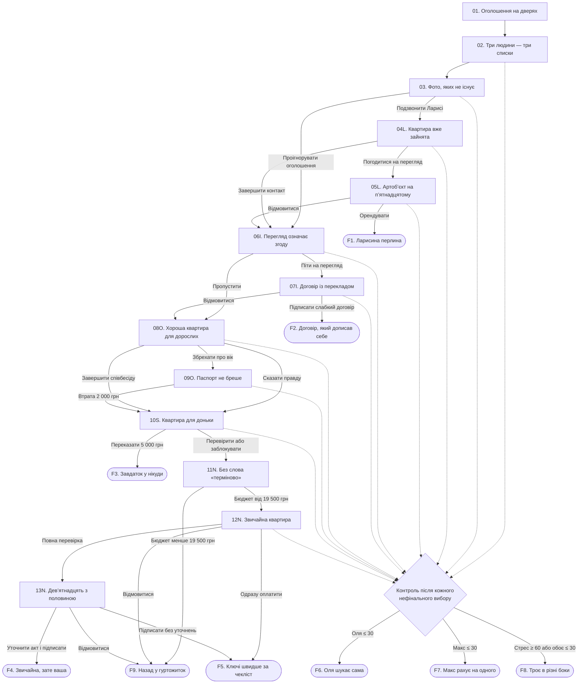

# Київська оренда

## 1. Назва сценарію

**«Київська оренда»**

Інтерактивна вебновела про трьох друзів, обмежений бюджет і квартири, які майже завжди мають приховане «але».

## 2. Коротка концепція

Гуртожиток Марти, Олі та Макса закривають на ремонт. Щоб не переїжджати в гірші умови іншого гуртожитку, друзі вирішують разом орендувати квартиру в Києві. У них є 20 000 гривень на перший платіж і супутні витрати та лише кілька днів на пошук.

Гравець ухвалює рішення за Марту. Треба балансувати між комфортом Олі, економністю Макса, власною чесністю та тиском ринку. Частина пропозицій небезпечна, частина просто невигідна, а деякі рішення псують стосунки швидше, ніж наближають переїзд. Хороший фінал можливий лише тоді, коли команда не витратить резерв, не розсвариться і дочекається нормального варіанта.

Основний конфлікт: швидко знайти житло, не погодившись на шахрайство, непрозорий договір або умови, через які друзі перестануть бути друзями.

## 3. Персонажі

### Марта

- **Роль у сюжеті:** головна героїня; гравець обирає її репліки та дії.
- **Характер:** організована, уважна, іноді надто бере відповідальність на себе.
- **Мотивація:** знайти квартиру вчасно й не допустити розпаду компанії.
- **Зв’язки:** сусідка по блоку та близька подруга Олі й Макса; часто стає посередницею між ними.

### Оля

- **Роль у сюжеті:** представляє потребу в комфорті, безпеці й нормальних побутових умовах.
- **Характер:** пряма, чутлива до знецінення, уважна до деталей.
- **Мотивація:** мати окрему кімнату, стабільний інтернет, можливість працювати й навчатися онлайн, доступ до укриття.
- **Зв’язки:** довіряє Марті, доки та справді її чують; часто сперечається з Максом через різні пріоритети.

### Макс

- **Роль у сюжеті:** представляє фінансову сторону пошуку.
- **Характер:** практичний, іронічний, готовий терпіти незручності заради низької ціни.
- **Мотивація:** не витратити всі гроші на оренду й не залізти в борги.
- **Зв’язки:** дружить із Мартою та Олею, але швидко дратується, коли його аргументи про бюджет ігнорують.

### Лариса

- **Роль у сюжеті:** напориста рієлторка, яка заманює клієнтів красивими неактуальними оголошеннями.
- **Характер:** невтомна, нав’язлива, будь-який недолік називає перевагою.
- **Мотивація:** закрити угоду й отримати 75% комісії.
- **Зв’язки:** після першого контакту постійно телефонує Марті, навіть якщо друзі відмовилися від її квартири.

### Ігнат

- **Роль у сюжеті:** рієлтор квартири на Васильківській.
- **Характер:** фамільярний, пасивно-агресивний, розмовляє так, ніби перегляд уже означає згоду.
- **Мотивація:** змусити клієнтів підписати слабкий договір, не фіксуючи додаткові платежі письмово.
- **Зв’язки:** тисне на Марту й Макса, а запитання Олі називає «зайвою бюрократією».

### Оксана

- **Роль у сюжеті:** власниця хорошої квартири без комісії.
- **Характер:** спочатку привітна, але упереджена щодо молодих орендарів.
- **Мотивація:** здати житло людям, яких вона вважає «дорослими й надійними».
- **Зв’язки:** спілкується з Мартою телефоном; брехню про вік викриває під час перевірки документів.

### Андрій

- **Роль у сюжеті:** рієлтор фінальної квартири.
- **Характер:** спокійний, конкретний, без штучної терміновості.
- **Мотивація:** провести зрозумілу угоду й отримати стандартну комісію 50%.
- **Зв’язки:** відповідає на всі запитання трійці та не приховує недоліків квартири.

### «Власниця з Viber»

- **Роль у сюжеті:** шахрайка, яка видає чуже житло за квартиру «для доньки».
- **Характер:** ввічлива, турботлива на словах, постійно підганяє.
- **Мотивація:** отримати 5 000 гривень «бронювання» до перегляду.
- **Зв’язки:** намагається швидко створити з Мартою штучну довіру.

### Комендантка

- **Роль у сюжеті:** оголошує про ремонт гуртожитку й запускає історію.
- **Характер:** суха й виснажена, не відповідає за рішення адміністрації.
- **Мотивація:** переселити мешканців у визначені строки.
- **Зв’язки:** знає трійцю як сусідів по одному блоку.

### Ігрові параметри

- **Стосунки з Олею:** старт — 50. Якщо показник падає до 30 або нижче, Оля виходить із пошуку й орендує кімнату сама.
- **Стосунки з Максом:** старт — 50. Якщо показник падає до 30 або нижче, Макс виходить із пошуку й орендує кімнату сам.
- **Бюджет:** старт — 20 000 грн. Це гроші, доступні зараз на перший платіж, комісію, дорогу й бронювання.
- **Стрес:** старт — 10. Якщо показник сягає 60, трійця свариться й припиняє спільний пошук.
- **Прапорці:** `larysa_contact`, `contract_checked`, `documents_checked`, `lied_to_oksana`, `scam_recognized`.

Числові значення стосунків і стресу приховані. Після вибору гравець бачить короткі сигнали: «Оля це запам’ятала», «Макс відчув, що його почули», «Тиск зростає». Сума фактичних витрат показується прямо.

**Контрольна перевірка після кожного нефінального вибору:**

1. Якщо стосунки з Олею і Максом одночасно не перевищують 30 або стрес дорівнює чи перевищує 60 — перехід до фіналу `F8`.
2. Інакше, якщо стосунки з Олею не перевищують 30 — перехід до фіналу `F6`.
3. Інакше, якщо стосунки з Максом не перевищують 30 — перехід до фіналу `F7`.
4. Якщо жодна умова не спрацювала — перехід до вказаної наступної сцени.

## 4. Карта сценарію

`Сцена 01 → Сцена 02`

`Сцена 02 → вибір принципу пошуку → контрольна перевірка → Сцена 03`

`Сцена 03 → перше оголошення`

- `Варіант А: подзвонити → контрольна перевірка → Сцена 04L`
- `Варіант Б: проігнорувати → контрольна перевірка → Сцена 06I`

`Сцена 04L → розмова з Ларисою`

- `Варіант А: погодитися на перегляд → контрольна перевірка → Сцена 05L`
- `Варіант Б: завершити контакт → контрольна перевірка → Сцена 06I`

`Сцена 05L → квартира Лариси`

- `Варіант А: орендувати → Фінал F1`
- `Варіант Б або В: відмовитися → контрольна перевірка → Сцена 06I`

`Сцена 06I → оголошення Ігната`

- `Варіант А: піти на перегляд → контрольна перевірка → Сцена 07I`
- `Варіант Б: пропустити → контрольна перевірка → Сцена 08O`

`Сцена 07I → квартира Ігната`

- `Варіант А: підписати → Фінал F2`
- `Варіант Б або В: відмовитися → контрольна перевірка → Сцена 08O`

`Сцена 08O → дзвінок Оксані`

- `Варіант А: сказати правду → контрольна перевірка → Сцена 10S`
- `Варіант Б: збрехати → контрольна перевірка → Сцена 09O`
- `Варіант В: завершити надто особисту співбесіду → контрольна перевірка → Сцена 10S`

`Сцена 09O → викриття брехні → витрата 2 000 грн → контрольна перевірка → Сцена 10S`

`Сцена 10S → шахрайська пропозиція`

- `Варіант А: переказати 5 000 грн → Фінал F3`
- `Варіант Б або В: не платити → контрольна перевірка → Сцена 11N`

`Сцена 11N → фінальна пропозиція Андрія`

- `Бюджет менше 19 500 грн → Фінал F9`
- `Бюджет від 19 500 грн → Сцена 12N`

`Сцена 12N → фінальний перегляд`

- `Варіант А: провести повну перевірку → контрольна перевірка → Сцена 13N`
- `Варіант Б: одразу перейти до оплати → Фінал F5`
- `Варіант В: відмовитися → Фінал F9`

`Сцена 13N → договір`

- `Варіант А: внести уточнення й підписати → Фінал F4`
- `Варіант Б: підписати без уточнень → Фінал F5`
- `Варіант В: відмовитися → Фінал F9`

Глобальні переходи контрольної перевірки: `низькі стосунки з Олею → F6`; `низькі стосунки з Максом → F7`; `критичний стрес або низькі стосунки з обома → F8`.

### 4.1. Розгалужена схема сцен

Суцільні стрілки показують основний сюжетний маршрут. Пунктирні стрілки означають перевірку прихованих параметрів після нефінального вибору; вона перериває основний маршрут лише тоді, коли спрацьовує одна з порогових умов.

## 5. Повний сценарій

#### Сцена 01. Оголошення на дверях

**Локація:** кімната в студентському гуртожитку.  
**Час:** понеділок, 19:10.  
**Учасники:** Марта, Оля, Макс, комендантка.  
**Передумова:** початок історії.

**Опис сцени:**  
У коридорі зникає світло. Під аварійною лампою комендантка приклеює до дверей оголошення: корпус закривають на ремонт, мешканці мають виселитися до кінця тижня. Усім пропонують місця в іншому гуртожитку — по четверо в кімнаті, далеко від корпусів університету.

**Діалог:**

**Комендантка:** До неділі здаєте ключі. Хто погоджується на переселення — завтра пише заяву.

**Оля:** А онлайн-пари я проводитиму з верхнього ліжка над трьома людьми?

**Комендантка:** Це вже організаційне питання.

**Макс:** Люблю фрази, після яких усі проблеми раптом стають твоїми.

**Марта:** У нас п’ять днів. Або переселення, або шукаємо квартиру разом.

**Оля:** Я за квартиру. Але мені потрібна окрема кімната й нормальний інтернет.

**Макс:** А мені потрібна ціна, після якої ще можна купити їжу.

**Марта:** Тоді сьогодні рахуємо гроші й домовляємося, що для кожного критично.

**Дія або вибір:**

- **Лінійна дія:** друзі сідають за стіл, відкривають банківські застосунки й складають спільний резерв → перехід до сцени `02`.

**Наслідок:**  
Встановлено дедлайн і стартовий бюджет — 20 000 грн. Стрес +5.

**Наступна сцена:** `02. Три людини — три списки`.

#### Сцена 02. Три людини — три списки

**Локація:** кухня гуртожитку.  
**Час:** того ж вечора, 20:00.  
**Учасники:** Марта, Оля, Макс.  
**Передумова:** зі сцени `01`, після рішення шукати квартиру разом.

**Опис сцени:**  
На столі лежать три аркуші. В Олі — «окрема кімната, інтернет, ванна, укриття». У Макса — «до 15 000, без зайвих платежів». Марта відкриває карту Києва й намагається скласти один список замість трьох.

**Діалог:**

**Оля:** Я працюю з дому. Якщо моя кімната прохідна, ви обоє вивчите всі мої робочі дзвінки.

**Макс:** А якщо квартира буде дорога, ми всі вивчимо смак гречки без нічого.

**Марта:** У нас є двадцять тисяч на старт. Не на мрії, а на реальний перший платіж і дорогу.

**Оля:** Я готова поступитися районом. Не готова поступитися безпекою й дверима.

**Макс:** Я готовий на старий ремонт. Не готовий платити за слово «лофт».

**Дія або вибір:**

- **Варіант А:** «Фіксуємо мінімум: окремі кімнати, безпечний будинок, письмові умови й повна сума до виїзду» → Оля +5, Макс +5, стрес −3 → контрольна перевірка → сцена `03`.
- **Варіант Б:** «Спершу дивимося найдешевше, а комфорт якось владнаємо» → Оля −8, Макс +5, стрес +5 → контрольна перевірка → сцена `03`.
- **Варіант В:** «Спершу дивимося найкращі умови, потім якось домовимося про гроші» → Оля +5, Макс −8, стрес +5 → контрольна перевірка → сцена `03`.

**Наслідок:**  
Формується початкова позиція Марти. Вона впливатиме на те, чи повірять друзі її подальшим аргументам.

**Наступна сцена:** `03. Фото, яких не існує`.

#### Сцена 03. Фото, яких не існує

**Локація:** інтерфейс сайту оголошень на ноутбуці.  
**Час:** вівторок, 08:15.  
**Учасники:** Марта, Оля, Макс.  
**Передумова:** зі сцени `02` після погодження або непогодження спільних критеріїв.

**Опис сцени:**  
На екрані — світла трикімнатна квартира біля центру за 10 000 грн. У підписі: «терміново, власник за кордоном, зробили ремонт для доньки». На різних фото не збігаються вікна й підлога. Контакт — рієлторка Лариса.

**Діалог:**

**Макс:** Десять тисяч. Або це диво, або фотографії старші за нас.

**Оля:** На другому фото кухня біла, на четвертому — зелена.

**Марта:** Можемо подзвонити й перевірити. Але нічого не обіцяємо.

**Макс:** Саме так усі й знайомляться з проблемами.

**Дія або вибір:**

- **Варіант А:** подзвонити Ларисі → встановити `larysa_contact` → стрес +4 → контрольна перевірка → сцена `04L`.
- **Варіант Б:** закрити підозріле оголошення й шукати далі → Оля +2, Макс −2, стрес −1 → контрольна перевірка → сцена `06I`.

**Наслідок:**  
Якщо Марта телефонує, Лариса отримує її номер і надалі регулярно нагадує про себе.

**Наступна сцена:** `04L. Квартира вже зайнята` або `06I. Перегляд означає згоду`.

#### Сцена 04L. Квартира вже зайнята

**Локація:** телефонна розмова; розділений екран.  
**Час:** вівторок, 08:20.  
**Учасники:** Марта, Лариса, Оля, Макс.  
**Передумова:** зі сцени `03`, якщо Марта подзвонила за підозрілим оголошенням.

**Опис сцени:**  
Лариса відповідає ще до другого гудка. Вона одразу повідомляє, що квартири з фото вже немає, але має «ще кращу» на Лук’янівці. Будинок пошкоджений під час атаки, квартира на п’ятнадцятому поверсі, ліфт працює не завжди. Оренда — 10 000 грн, комісія Лариси — 75%.

**Діалог:**

**Лариса:** Ви дуже вчасно, але саме цю вже забрали. Буквально хвилину тому.

**Марта:** Оголошення опублікували десять хвилин тому.

**Лариса:** Київський ринок швидкий. Зате є унікальний варіант на Лук’янівці. Вид із п’ятнадцятого поверху, ванна, простір.

**Оля:** А що з будинком?

**Лариса:** Є косметичні особливості фасаду. У третьому під’їзді був приліт, але квартира в другому.

**Макс:** Скільки все разом при заселенні?

**Лариса:** Сімнадцять з половиною зараз. Решту застави власник дозволяє потім. Я можу під’їхати машиною за двадцять хвилин.

**Дія або вибір:**

- **Варіант А:** погодитися на перегляд → Оля −3, Макс +3, стрес +6 → контрольна перевірка → сцена `05L`.
- **Варіант Б:** відповісти, що підміна оголошення й пошкоджений будинок не підходять, та завершити дзвінок → Оля +4, Макс −3, стрес −2 → контрольна перевірка → сцена `06I`.

**Наслідок:**  
Якщо гравець відмовляється, Лариса все одно надсилатиме голосові повідомлення між наступними сценами. Вони не змінюють маршрут, але додають відчуття тиску.

**Наступна сцена:** `05L. Артоб’єкт на п’ятнадцятому` або `06I. Перегляд означає згоду`.

#### Сцена 05L. Артоб’єкт на п’ятнадцятому

**Локація:** пошкоджена багатоповерхівка на Лук’янівці; квартира.  
**Час:** вівторок, 09:05.  
**Учасники:** Марта, Оля, Макс, Лариса.  
**Передумова:** зі сцени `04L`, якщо друзі погодилися на перегляд.

**Опис сцени:**  
Біля входу видно закриту частину двору й пошкоджений фасад сусіднього під’їзду. Ліфт доїжджає лише до дванадцятого поверху. У квартирі три кімнати, але одна прохідна. У ванній стоїть стара ванна, під нею калюжа, на стіні темна пляма. Найближче укриття — за десять хвилин.

**Діалог:**

**Лариса:** Зате зверху ніхто не тупає. І краєвид такий, що всі недоліки стають концепцією.

**Оля:** Вода під ванною — теж концепція?

**Лариса:** Це після прибирання. Просохне.

**Макс:** Десять тисяч за три кімнати. Ми можемо викликати майстра.

**Оля:** Ми на п’ятнадцятому поверсі в будинку з пошкодженням, без стабільного ліфта й нормального укриття.

**Лариса:** Молоді люди, ви або бачите можливості, або бачите калюжу.

**Оля:** Я бачу калюжу, бо вона буквально під ногами.

**Макс:** Ванна хоча б є. Оля ж хотіла ванну.

**Марта:** Питання не у ванні. Питання в тому, скільки ризиків ми зараз називаємо низькою ціною.

**Дія або вибір:**

- **Варіант А:** «Беремо. За таку ціну кращого не буде» → Макс +7, Оля −12, стрес +15, бюджет −17 500 грн → перехід до фіналу `F1`.
- **Варіант Б:** «Олю, ти права: безпека важливіша. Відмовляємося» → Оля +7, Макс −6, стрес −2 → контрольна перевірка → сцена `06I`.
- **Варіант В:** вимагати акт про пошкодження, ремонт протікання й письмову інформацію про стан будинку; після відмови Лариси піти → Оля +4, Макс +3, стрес −5 → контрольна перевірка → сцена `06I`.

**Наслідок:**  
Оренда завершує пошук поганим, але не шахрайським фіналом. Відмова зберігає гроші, однак Лариса продовжує телефонувати.

**Наступна сцена:** `F1. Ларисина перлина` або `06I. Перегляд означає згоду`.

#### Сцена 06I. Перегляд означає згоду

**Локація:** коридор університету; екран телефона.  
**Час:** середа, 12:40.  
**Учасники:** Марта, Оля, Макс, Лариса у голосових повідомленнях.  
**Передумова:** після відмови Ларисі або після ігнорування її оголошення.

**Опис сцени:**  
Марта знаходить трикімнатну квартиру біля Васильківської за 12 000 грн. Фото неідеальні, але схожі між собою. У картці вказано комісію 50%. Рієлтор Ігнат надсилає відео й пише: «Дивіться уважно, щоб на місці вже оформляти». Якщо активний прапорець `larysa_contact`, поверх екрана з’являється її повідомлення: «Я вам ще одну перлину знайшла, передзвоніть».

**Діалог:**

**Макс:** Дванадцять плюс половина комісії — вісімнадцять. Ми вкладаємося.

**Оля:** На фото чисто. І три двері. Уже прогрес.

**Марта:** Мене бентежить тільки фраза «на місці вже оформляти».

**Макс:** Можемо подивитися й нічого не підписувати.

**Оля:** Скажи це ще раз перед дверима, щоб ми всі запам’ятали.

**Дія або вибір:**

- **Варіант А:** погодитися на перегляд, але письмово уточнити, що рішення буде після читання договору → Макс +3, Оля +2, стрес +3 → контрольна перевірка → сцена `07I`.
- **Варіант Б:** пропустити квартиру через тиск ще до зустрічі → Макс −5, Оля +2, стрес −2 → контрольна перевірка → сцена `08O`.

**Наслідок:**  
Ігнат відповідає на уточнення емодзі «ок», але поводитиметься так, ніби угода вже погоджена.

**Наступна сцена:** `07I. Договір із перекладом` або `08O. Хороша квартира для дорослих`.

#### Сцена 07I. Договір із перекладом

**Локація:** квартира біля Васильківської.  
**Час:** середа, 18:00.  
**Учасники:** Марта, Оля, Макс, Ігнат.  
**Передумова:** зі сцени `06I`, якщо друзі погодилися на перегляд.

**Опис сцени:**  
Квартира справді непогана: старий, але чистий ремонт, три окремі кімнати, поруч метро. Ігнат одразу дістає договір. Текст схожий на невдалий машинний переклад: речення обриваються, сума застави згадана двічі по-різному. Усно Ігнат додає обов’язкове прибирання після виїзду за 5 000 грн і можливість власника переглядати квартиру без чіткого попередження. У договорі цього немає.

**Діалог:**

**Ігнат:** Ну що, все як на відео. Я думав, ви вже приїхали оформляти.

**Марта:** Ми писали, що рішення буде після договору.

**Ігнат:** Та звісно. Читайте, тільки в мене наступні люди за сорок хвилин.

**Оля:** Тут написано: «наймач зобов’язаний повернення майна в стані первинного виникнення».

**Макс:** Може, це юридична поезія.

**Марта:** Де вказане прибирання за п’ять тисяч?

**Ігнат:** Це стандартна умова, її всі знають. Не бачу сенсу роздувати договір.

**Оля:** А візити власника?

**Ігнат:** Якщо ви нормально живете, чого вам боятися?

**Макс:** Сама квартира нормальна. Може, просто попросимо виправити текст?

**Ігнат:** Переробляти шаблон ніхто не буде. Або беремо, або не затримуємо одне одного.

**Дія або вибір:**

- **Варіант А:** підписати договір як є, щоб не втратити квартиру → Макс +5, Оля −9, стрес +12, бюджет −18 000 грн → перехід до фіналу `F2`.
- **Варіант Б:** вимагати вписати всі платежі, порядок візитів і повернення застави; після відмови піти → Оля +5, Макс +2, стрес +2, встановити `contract_checked` → контрольна перевірка → сцена `08O`.
- **Варіант В:** сказати Олі, що вона чіпляється до слів, але все одно відмовитися через додаткові 5 000 грн → Оля −10, Макс +3, стрес +8 → контрольна перевірка → сцена `08O`.

**Наслідок:**  
Підписання завершує пошук квартирою з прихованими майбутніми витратами. Відмова зберігає бюджет і відкриває наступну пропозицію.

**Наступна сцена:** `F2. Договір, який дописав себе` або `08O. Хороша квартира для дорослих`.

#### Сцена 08O. Хороша квартира для дорослих

**Локація:** кухня гуртожитку; телефонна розмова.  
**Час:** четвер, 09:30.  
**Учасники:** Марта, Оля, Макс, Оксана.  
**Передумова:** після відмови від Ігната або пропуску його оголошення.

**Опис сцени:**  
З’являється свіже оголошення від власниці: охайна трикімнатна квартира на Сирці, 15 000 грн, без комісії. Оксана привітно описує ремонт, а потім переходить до запитань про вік, роботу й батьків. Друзі мовчки слухають розмову на гучному зв’язку.

**Діалог:**

**Оксана:** Квартира після ремонту, техніка нова. Скажіть, будь ласка, скільки вам років?

**Марта:** Нам двадцять один-двадцять два.

**Оксана:** Ви працюєте чи тільки вчитеся?

**Макс** *(пошепки):* І працюємо, і вчимося. Це буквально правда.

**Оксана:** Я просто не хочу дітей, за яких незрозуміло хто платитиме. Мені потрібні люди хоча б від двадцяти семи, зі стабільною роботою.

**Оля** *(пошепки):* Якщо їй уже не підходимо, не треба вмовляти.

**Макс** *(пошепки):* Квартира хороша й без комісії. Можна сказати, що нам по двадцять сім.

**Марта:** Оксано, я вас почула.

**Дія або вибір:**

- **Варіант А:** чесно назвати вік, роботу й навчання → Оксана відмовляє; Оля +3, Макс −2, стрес +5 → контрольна перевірка → сцена `10S`.
- **Варіант Б:** сказати, що всім по двадцять сім і всі працюють повний день → Макс +4, Оля −7, стрес +6, встановити `lied_to_oksana` → контрольна перевірка → сцена `09O`.
- **Варіант В:** відмовитися відповідати на питання про батьків і завершити розмову → Оля +5, Макс −4, стрес −1 → контрольна перевірка → сцена `10S`.

**Наслідок:**  
Чесна відповідь або встановлення меж закриває цю пропозицію без фінансових втрат. Брехня відкриває коротку гілку з гарантованим викриттям.

**Наступна сцена:** `09O. Паспорт не бреше` або `10S. Квартира для доньки`.

#### Сцена 09O. Паспорт не бреше

**Локація:** таксі; потім квартира Оксани на Сирці.  
**Час:** четвер, 10:20.  
**Учасники:** Марта, Оля, Макс, Оксана.  
**Передумова:** зі сцени `08O`, якщо Марта збрехала про вік і зайнятість.

**Опис сцени:**  
Оксана вимагає приїхати якнайшвидше. Друзі беруть таксі в годину пік, бо бояться, що квартира дістанеться іншим. Дорога туди й назад коштує 2 000 грн. Квартира справді хороша. Біля столу Оксана просить паспорти для договору.

**Діалог:**

**Оксана:** Нарешті люди, з якими можна говорити серйозно. Давайте документи, я перепишу дані.

**Марта:** Можемо спершу прочитати договір?

**Оксана:** Звісно. Паспорт дайте, поки ви читаєте.

**Оля:** Марто, це зараз і закінчиться.

**Макс:** Може, вона не дивитиметься на дату.

**Оксана:** Двадцять один? Ви ж сказали — двадцять сім.

**Марта:** Ми боялися, що ви навіть не дасте нам шансу.

**Оксана:** Після брехні шансів точно немає. Прошу вийти.

**Макс:** Дві тисячі за екскурсію гарною квартирою.

**Оля:** Не квартира нас обдурила. Ми самі вирішили, що брехня спрацює.

**Дія або вибір:**

- **Лінійна дія:** друзі залишають квартиру й повертаються до гуртожитку → бюджет −2 000 грн, Оля −3, Макс −3, стрес +12 → контрольна перевірка → сцена `10S`.

**Наслідок:**  
Бюджет зменшується до 18 000 грн. Через це фінальна квартира стане недоступною, навіть якщо команда дійде до неї.

**Наступна сцена:** `10S. Квартира для доньки`.

#### Сцена 10S. Квартира для доньки

**Локація:** груповий чат і Viber на телефоні Марти.  
**Час:** четвер, 21:15.  
**Учасники:** Марта, Оля, Макс, «власниця з Viber».  
**Передумова:** після завершення гілки Оксани.

**Опис сцени:**  
Увечері Марта бачить оголошення: сучасна трикімнатна квартира на Подолі за 10 000 грн. «Власниця» пише, що ремонт робили для доньки, але та виїхала за кордон. Після кількох доброзичливих повідомлень жінка просить 5 000 грн, щоб забронювати квартиру до завтрашнього перегляду. Надсилає фото паспорта, але відмовляється від відеодзвінка.

**Діалог:**

**Власниця з Viber:** Ми з чоловіком порадилися. Ви справляєте враження дуже хороших людей.

**Макс:** Вона це зрозуміла з трьох повідомлень?

**Власниця з Viber:** Я готова відмовити іншим. Перекиньте п’ять тисяч бронювання, і оголошення одразу видаляю.

**Оля:** Попроси показати квартиру наживо. Хоча б відео з вікна.

**Марта:** Вона каже, що зараз у селі й зв’язок слабкий.

**Макс:** Фото паспорта нічого не доводить. Воно може бути чиє завгодно.

**Власниця з Viber:** Вирішіть за десять хвилин, бо люди вже готові платити.

**Дія або вибір:**

- **Варіант А:** переказати 5 000 грн, щоб не втратити дешеву квартиру → бюджет −5 000 грн, стрес +20 → перехід до фіналу `F3`.
- **Варіант Б:** попросити відеодзвінок із квартири, документ про право власності й ім’я отримувача картки → співрозмовниця видаляє чат; Оля +4, Макс +4, стрес +3, встановити `scam_recognized` → контрольна перевірка → сцена `11N`.
- **Варіант В:** одразу заблокувати контакт і поскаржитися на оголошення → Оля +2, Макс +3, стрес −2, встановити `scam_recognized` → контрольна перевірка → сцена `11N`.

**Наслідок:**  
Переказ коштів завершує гру негайно: команда втрачає гроші й уже не має достатнього резерву для безпечного переїзду. Обережна дія зберігає шанс на фінальну пропозицію.

**Наступна сцена:** `F3. Завдаток у нікуди` або `11N. Без слова «терміново»`.

#### Сцена 11N. Без слова «терміново»

**Локація:** читальна зала університету; телефон Марти.  
**Час:** п’ятниця, 13:00.  
**Учасники:** Марта, Оля, Макс, Андрій; Лариса у повідомленні, якщо активний відповідний прапорець.  
**Передумова:** після відмови від шахрайської пропозиції.

**Опис сцени:**  
Марта отримує відповідь на старий запит. Рієлтор Андрій пропонує звичайну трикімнатну квартиру на Оболоні: 13 000 грн оренди, 50% комісії, разом 19 500 грн при заселенні. Страховий платіж власник погодився розділити на два наступні місяці. Андрій одразу надсилає адресу, план квартири й чернетку договору. Якщо Марта колись говорила з Ларисою, та в цей момент телефонує з нового номера; Марта скидає виклик.

**Діалог:**

**Андрій:** Одразу про мінуси: кухня маленька, ремонт не новий, до метро дванадцять хвилин. Три кімнати окремі, будинок без пошкоджень, укриття в школі навпроти.

**Оля:** Він сам назвав мінуси. Це точно рієлтор?

**Макс:** Тринадцять плюс шість із половиною — дев’ятнадцять п’ятсот.

**Марта:** Якщо ми ніде не витратилися, вистачає майже впритул.

**Андрій:** Можете спершу прочитати договір. Перегляд о шостій, рішення не зобов’язані давати на місці.

**Макс:** Ще й без таймера. Підозріло нормально.

**Дія або вибір:**

- **Автоматична перевірка бюджету:** якщо бюджет менший за 19 500 грн, друзі не можуть сплатити перший платіж і комісію → перехід до фіналу `F9`.
- **Автоматичний перехід:** якщо бюджет становить 19 500 грн або більше, друзі підтверджують перегляд → стрес −5 → перехід до сцени `12N`.

**Наслідок:**  
Наслідок попередніх фінансових рішень стає прямим: після невдалої поїздки до Оксани грошей на цей варіант уже не вистачає.

**Наступна сцена:** `12N. Звичайна квартира` або `F9. Назад у гуртожиток`.

#### Сцена 12N. Звичайна квартира

**Локація:** трикімнатна квартира на Оболоні.  
**Час:** п’ятниця, 18:00.  
**Учасники:** Марта, Оля, Макс, Андрій.  
**Передумова:** зі сцени `11N`, якщо бюджет не менший за 19 500 грн.

**Опис сцени:**  
У квартирі немає дизайнерських меблів, зате всі кімнати окремі, вода не тече, вікна зачиняються, мобільний інтернет працює. Андрій показує лічильники, документи власника й вихід до укриття. На стіні в коридорі є потертість, на пральній машині — подряпина. Усе можна внести до акта приймання.

**Діалог:**

**Оля:** У моїй кімнаті є двері, розетка й стіл. Я вже боюся радіти.

**Макс:** Кухня справді маленька.

**Марта:** Ми в гуртожитку готували на одній конфорці між двома каструлями. Переживемо.

**Андрій:** Ось витяг про право власності. Власник один. Ось останні квитанції й контакти для аварійних ситуацій.

**Оля:** А якщо під час відключення не буде води?

**Андрій:** Насос залежить від електрики. У підвалі є бак, але це незручність, яку краще знати зараз.

**Макс:** Нарешті недолік, який не назвали артоб’єктом.

**Марта:** Перевіримо все по списку й вирішимо.

**Дія або вибір:**

- **Варіант А:** перевірити право власності, воду, вікна, лічильники, інтернет, укриття та зафіксувати дефекти → Оля +5, Макс +3, стрес −6, встановити `documents_checked` → контрольна перевірка → сцена `13N`.
- **Варіант Б:** не витрачати час на перевірку й одразу перейти до оплати → бюджет −19 500 грн, стрес +5 → перехід до фіналу `F5`.
- **Варіант В:** відмовитися, бо квартира не виглядає достатньо сучасною → Макс −7, Оля −4, стрес +8 → перехід до фіналу `F9`.

**Наслідок:**  
Повна перевірка відкриває найкращий фінал. Поспіх дає квартиру, але не гарантує прозорого стану майна й платежів.

**Наступна сцена:** `13N. Дев’ятнадцять з половиною` або один із фіналів `F5`, `F9`.

#### Сцена 13N. Дев’ятнадцять з половиною

**Локація:** кухня фінальної квартири.  
**Час:** п’ятниця, 19:00.  
**Учасники:** Марта, Оля, Макс, Андрій.  
**Передумова:** зі сцени `12N`, якщо друзі провели повну перевірку.

**Опис сцени:**  
На столі лежить договір. Основні суми та строки збігаються з повідомленнями Андрія. У договорі є правило про попередження перед візитом власника, але в акті ще не записані показники лічильників, подряпина на машинці та потертість у коридорі.

**Діалог:**

**Марта:** У договорі все збігається. Треба лише додати дефекти й показники в акт.

**Андрій:** Додавайте. Я сфотографую підписаний примірник і надішлю всім.

**Макс:** Після цього в нас лишиться п’ятсот гривень.

**Оля:** Зате не мінус п’ять тисяч і не ванна з власною екосистемою.

**Марта:** Страховий платіж піде двома частинами з наступних доходів. Це теж записано.

**Андрій:** Так. Якщо суми й строки вам зрозумілі, можемо підписувати.

**Дія або вибір:**

- **Варіант А:** дописати показники, дефекти й строк повернення страхового платежу; перечитати та підписати → бюджет −19 500 грн, Оля +5, Макс +5, стрес −8 → перехід до фіналу `F4`.
- **Варіант Б:** підписати основний договір без уточнення акта, бо всі втомилися → бюджет −19 500 грн, стрес +4 → перехід до фіналу `F5`.
- **Варіант В:** злякатися останньої миті й відмовитися від угоди → бюджет без змін, Оля −5, Макс −6, стрес +10 → перехід до фіналу `F9`.

**Наслідок:**  
Фінальний вибір визначає, чи команда отримає безпечну угоду, поспішний компроміс або залишиться без квартири.

**Наступна сцена:** один із фіналів `F4`, `F5`, `F9`.

#### Фінал F1. Ларисина перлина

**Локація:** квартира на Лук’янівці.  
**Час:** через тиждень після заселення.  
**Учасники:** Марта, Оля, Макс, Лариса в голосовому повідомленні.  
**Передумова:** зі сцени `05L`, якщо Марта погодилася орендувати квартиру.

**Опис сцени:**  
У коридорі стоять коробки. Ліфт знову не працює, під ванною повернулася вода, а Оля проводить робочий дзвінок у навушниках у прохідній кімнаті. На телефоні Марти — голосове від Лариси з пропозицією «ще кращого варіанта».

**Діалог:**

**Макс:** Якщо не рахувати ліфт, воду й комісію, ми справді зекономили.

**Оля:** А якщо не рахувати квартиру, то взагалі майже нічого не витратили.

**Марта:** Ми поспішили. Наступного разу низька ціна не буде аргументом проти всього списку.

**Лариса** *(з телефона):* Марточко, є перлина на Троєщині. Балкон із ванною, дуже ексклюзивно.

**Дія або вибір:**

- **Лінійна дія:** Марта блокує черговий номер Лариси → завершення історії.

**Наслідок:**  
Квартира знайдена, але безпекою та комфортом пожертвували заради ціни. Стосунки з Олею погіршилися, пошук доведеться повторити після завершення короткого договору.

**Наступна сцена:** завершення.

#### Фінал F2. Договір, який дописав себе

**Локація:** квартира біля Васильківської.  
**Час:** день виїзду через кілька місяців.  
**Учасники:** Марта, Оля, Макс, Ігнат телефоном.  
**Передумова:** зі сцени `07I`, якщо команда підписала непрозорий договір.

**Опис сцени:**  
Квартира чиста, але Ігнат надсилає рахунок на 5 000 грн за «обов’язковий клінінг». Власник утримує цю суму зі страхового платежу. У договорі такого пункту немає, але усна домовленість нічого не доводить.

**Діалог:**

**Оля:** Ми питали, чому цього немає в договорі.

**Макс:** І все одно підписали, бо втомилися шукати.

**Марта:** Квартира була нормальною. Угода — ні.

**Ігнат** *(телефоном):* Я ж вам казав про клінінг. Те, що ви не записали, — не моя проблема.

**Дія або вибір:**

- **Лінійна дія:** друзі зберігають листування й вирішують більше не приймати усні умови → завершення історії.

**Наслідок:**  
Команда отримала житло, але заплатила за поспіх і непрозорий договір.

**Наступна сцена:** завершення.

#### Фінал F3. Завдаток у нікуди

**Локація:** кухня гуртожитку; екран телефона.  
**Час:** одразу після переказу.  
**Учасники:** Марта, Оля, Макс.  
**Передумова:** зі сцени `10S`, якщо Марта переказала 5 000 грн до перегляду.

**Опис сцени:**  
Повідомлення лишається непрочитаним. За хвилину зникають фото профілю, чат і саме оголошення. Номер недоступний. На екрані банку — успішний переказ.

**Діалог:**

**Марта:** Вона видалила чат.

**Макс:** Спробуй подзвонити.

**Марта:** Номер уже не існує.

**Оля:** Ми заплатили не за квартиру. Ми заплатили за десять хвилин чужого тиску.

**Макс:** Тепер резерву точно не вистачить на нормальне заселення.

**Марта:** На нормальний стартовий платіж уже не вистачить.

**Дія або вибір:**

- **Лінійна дія:** Марта звертається до банку та подає заяву, але повернення грошей не гарантоване → завершення історії.

**Наслідок:**  
Гроші втрачено, квартиру не знайдено. Друзі погоджуються на переселення в інший гуртожиток.

**Наступна сцена:** завершення.

#### Фінал F4. Звичайна, зате ваша

**Локація:** фінальна квартира на Оболоні.  
**Час:** субота, день переїзду.  
**Учасники:** Марта, Оля, Макс.  
**Передумова:** зі сцени `13N`, якщо команда перевірила квартиру, доповнила документи й підписала договір.

**Опис сцени:**  
У кімнатах стоять коробки. Оля перевіряє відеодзвінок за своїм столом. Макс урочисто ставить на маленьку кухню пачку гречки. Марта вішає на холодильник їхній перший список критеріїв.

**Діалог:**

**Оля:** Інтернет не зник. Двері зачиняються. Я майже не вірю.

**Макс:** У нас п’ятсот гривень, зате жодної комісії в сімдесят п’ять відсотків.

**Марта:** І всі суми записані. І подряпина записана. І навіть маленька кухня була чесно заявлена.

**Оля:** Виходить, нормальна квартира — це коли тебе не переконують, що проблема є перевагою.

**Макс:** Не руйнуй магію ринку нерухомості.

**Дія або вибір:**

- **Лінійна дія:** друзі замовляють найдешевшу піцу й вечеряють на коробках → завершення історії.

**Наслідок:**  
Найкращий фінал. Команда збереглася, ризики перевірено, а квартира відповідає погодженому мінімуму. Вона не ідеальна, але угода зрозуміла.

**Наступна сцена:** завершення.

#### Фінал F5. Ключі швидше за чекліст

**Локація:** фінальна квартира на Оболоні.  
**Час:** перший вечір після заселення.  
**Учасники:** Марта, Оля, Макс.  
**Передумова:** зі сцени `12N` або `13N`, якщо друзі підписали угоду без повної перевірки чи уточненого акта.

**Опис сцени:**  
Ключі вже в Марти. Під час першого прання Макс помічає стару тріщину на дверцятах машинки, якої немає в акті. Це не катастрофа, але тепер доведеться окремо доводити, що пошкодження було раніше.

**Діалог:**

**Макс:** Скажіть, що ця тріщина була тут.

**Оля:** Була. Ми просто не записали.

**Марта:** Напишу Андрію зараз і надішлю фото. Може, власник підтвердить.

**Макс:** Квартира хороша. Просто ми знову вирішили, що п’ять хвилин нічого не змінять.

**Дія або вибір:**

- **Лінійна дія:** Марта фіксує дефект у листуванні й зберігає фото → завершення історії.

**Наслідок:**  
Команда має житло й лишається разом, але фінал нагадує: навіть із нормальними людьми документи треба доводити до кінця.

**Наступна сцена:** завершення.

#### Фінал F6. Оля шукає сама

**Локація:** коридор гуртожитку.  
**Час:** момент спрацювання контрольної перевірки.  
**Учасники:** Марта, Оля, Макс.  
**Передумова:** після будь-якого нефінального вибору, якщо стосунки з Олею знизилися до 30 або нижче, а умова фіналу `F8` не спрацювала.

**Опис сцени:**  
Оля закриває ноутбук і прибирає зі столу свій список. Вона більше не сперечається — просто повідомляє рішення.

**Діалог:**

**Оля:** Я весь час пояснюю, що мені потрібне місце, де можна працювати й почуватися безпечно. Якщо це щоразу «зайві вимоги», я краще знайду кімнату сама.

**Марта:** Ми можемо ще переглянути критерії.

**Оля:** Ми вже переглядали. Переважно в бік того, що мої умови можна не враховувати.

**Макс:** Тоді на двох квартира буде дорожча.

**Оля:** Саме тому я кажу зараз, а не після підписання.

**Дія або вибір:**

- **Лінійна дія:** Оля виходить зі спільного чату пошуку → завершення історії.

**Наслідок:**  
Спільний бюджет більше не покриває трикімнатні варіанти. Марта й Макс відмовляються від плану, Оля знаходить окрему кімнату.

**Наступна сцена:** завершення.

#### Фінал F7. Макс рахує на одного

**Локація:** сходи гуртожитку.  
**Час:** момент спрацювання контрольної перевірки.  
**Учасники:** Марта, Оля, Макс.  
**Передумова:** після будь-якого нефінального вибору, якщо стосунки з Максом знизилися до 30 або нижче, а умова фіналу `F8` не спрацювала.

**Опис сцени:**  
Макс показує на телефоні оголошення про кімнату. Він уже домовився про перегляд наодинці.

**Діалог:**

**Макс:** Я не проти комфорту. Я проти того, щоб кожна розмова про гроші звучала як жадібність.

**Марта:** Ми ще можемо знайти баланс.

**Макс:** Баланс — це коли мій ліміт теж умова, а не перешкода. Я не потягну ваш варіант і не хочу позичати.

**Оля:** Можна було сказати раніше.

**Макс:** Я казав. Просто це не впливало на рішення.

**Дія або вибір:**

- **Лінійна дія:** Макс залишає спільний пошук і їде дивитися окрему кімнату → завершення історії.

**Наслідок:**  
Без частки Макса спільна квартира стає недоступною. Марта й Оля погоджуються на переселення, а Макс винаймає кімнату сам.

**Наступна сцена:** завершення.

#### Фінал F8. Троє в різні боки

**Локація:** кухня гуртожитку.  
**Час:** пізній вечір у день спрацювання контрольної перевірки.  
**Учасники:** Марта, Оля, Макс.  
**Передумова:** після будь-якого нефінального вибору, якщо стрес досяг 60 або стосунки з обома друзями не перевищують 30.

**Опис сцени:**  
На столі одночасно дзвонять три телефони. Лариса лишає голосове, сайт надсилає нові оголошення, комендантка нагадує про ключі. Розмова переходить у сварку.

**Діалог:**

**Оля:** Ми вже не шукаємо квартиру. Ми просто по черзі доводимо, чиї потреби менш важливі.

**Макс:** І витрачаємо гроші, яких у нас немає.

**Марта:** Я намагалася втримати все разом.

**Оля:** Але рішення за всіх — це не те саме, що разом.

**Макс:** Зупинімося, поки ми ще можемо нормально говорити.

**Дія або вибір:**

- **Лінійна дія:** друзі закривають спільну таблицю й розходяться шукати окремі варіанти → завершення історії.

**Наслідок:**  
Квартиру разом не знайдено. Конфлікт не обов’язково завершує дружбу назавжди, але спільний переїзд скасовано.

**Наступна сцена:** завершення.

#### Фінал F9. Назад у гуртожиток

**Локація:** інший студентський гуртожиток.  
**Час:** неділя, 20:30.  
**Учасники:** Марта, Оля, Макс; нові сусіди поза кадром.  
**Передумова:** зі сцени `11N`, якщо бюджету менше 19 500 грн; або зі сцен `12N` чи `13N`, якщо команда відмовилася від останньої квартири.

**Опис сцени:**  
Трійця заносить речі до тісної кімнати з двома двоповерховими ліжками. За ширмою хтось веде відеодзвінок, у коридорі черга до душу. Це саме переселення, якого друзі намагалися уникнути.

**Діалог:**

**Макс:** Зате без комісії.

**Оля:** І з трьома незапланованими сусідами.

**Марта:** Ми не знайшли квартиру, але хоча б не підписали те, чого не розуміли.

**Макс** *(якщо активний прапорець `lied_to_oksana`):* І ще мінус дві тисячі за таксі до квартири, якої в нас не могло бути.

**Макс** *(якщо прапорець `lied_to_oksana` неактивний):* Зате гроші ми не втратили.

**Оля:** Наступний пошук почнемо не з оголошень. Почнемо з бюджету й правил.

**Марта:** І без брехні про вік.

**Дія або вибір:**

- **Лінійна дія:** Марта створює нову нотатку «Пошук житла — друга спроба» → завершення історії.

**Наслідок:**  
Команда лишилася без квартири, але може зберегти дружбу й спробувати знову. Це наслідок втрачених грошей, відмови від останнього варіанта або надмірної обережності після всіх попередніх ризиків.

**Наступна сцена:** завершення.

## 6. Авторські доповнення

- Уточнено стартову причину пошуку: закриття гуртожитку на ремонт і небажане переселення. Це прямо розвиває командну пропозицію та створює зрозумілий дедлайн.
- Додано точні суми першого платежу, комісій і транспортних витрат, щоб бюджет у гривнях реально впливав на доступність фінальної квартири.
- Створено ім’я й манеру спілкування нормального рієлтора Андрія. Команда визначила його функцію та комісію, але не дала готового персонажа.
- Деталізовано квартири: Лук’янівка з пошкодженим будинком, Васильківська з непрозорим договором, Сирець із власницею, яка відсіює молодь, і фінальна Оболонь. Деталі базуються на названих командою ризиках: безпека, блекаути, укриття, стан ремонту, приховані платежі та ейджизм.
- Додано контрольні правила переходу до фіналів за окремими стосунками з Олею й Максом та за рівнем стресу. Це перетворює обговорені параметри на однозначну сценарну логіку.
- Дописано повні діалоги, реакції, проміжні наслідки й дев’ять завершених фіналів. Вони потрібні, щоб жоден вибір не залишався без переходу, а кожна гілка мала сюжетне завершення.
