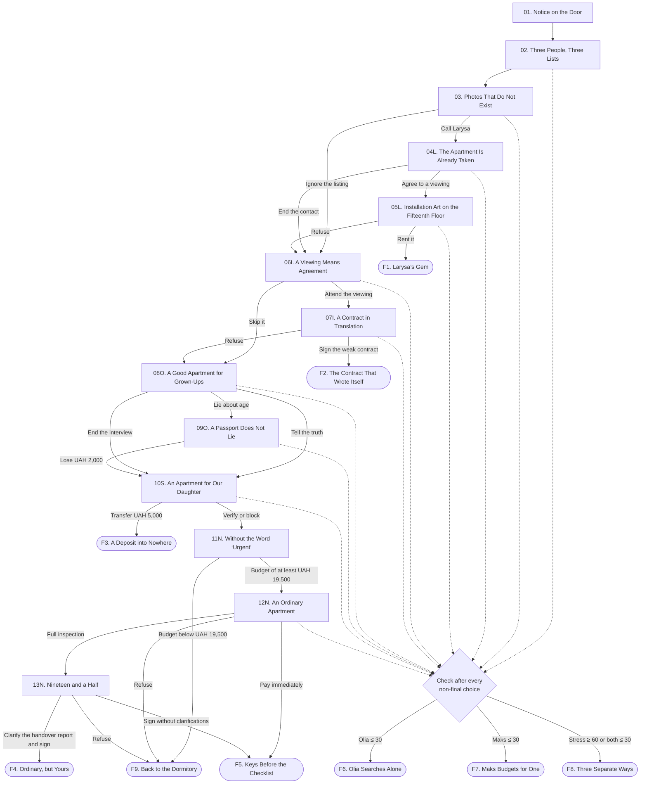

# Kyiv Rental

## 1. Scenario title

**Kyiv Rental**

An interactive web novel about three friends, a limited budget, and apartments that almost always come with a hidden catch.

## 2. Short concept

The dormitory where Marta, Olia, and Maks live is closing for renovations. Rather than move into worse conditions at another dormitory, the friends decide to rent an apartment together in Kyiv. They have UAH 20,000 for the initial payment and related expenses, and only a few days to find a place.

The player makes decisions on Marta’s behalf. They must balance Olia’s need for comfort, Maks’s frugality, Marta’s own honesty, and the pressure of the rental market. Some offers are dangerous, some are simply poor value, and some decisions damage the friends’ relationships faster than they bring the group closer to moving. A good ending is possible only if the group preserves its financial reserve, avoids falling out, and waits for a reasonable option.

The central conflict is to find a home quickly without accepting fraud, an opaque contract, or conditions that cause the friends to stop being friends.

## 3. Characters

### Marta

- **Role in the story:** the protagonist; the player chooses her lines and actions.
- **Personality:** organized and attentive, but sometimes takes too much responsibility upon herself.
- **Motivation:** find an apartment in time and prevent the group from falling apart.
- **Relationships:** Olia and Maks’s blockmate and close friend; often mediates between them.

### Olia

- **Role in the story:** represents the need for comfort, safety, and reasonable living conditions.
- **Personality:** direct, sensitive to having her concerns dismissed, and attentive to detail.
- **Motivation:** have a private room, reliable internet, the ability to work and study online, and access to a shelter.
- **Relationships:** trusts Marta as long as she genuinely feels heard; frequently argues with Maks because their priorities differ.

### Maks

- **Role in the story:** represents the financial side of the search.
- **Personality:** practical and ironic; willing to tolerate inconvenience in exchange for a low price.
- **Motivation:** avoid spending all their money on rent or going into debt.
- **Relationships:** friends with Marta and Olia, but quickly becomes frustrated when his budget concerns are ignored.

### Larysa

- **Role in the story:** a pushy realtor who attracts clients with appealing but outdated listings.
- **Personality:** tireless and intrusive; reframes every defect as an advantage.
- **Motivation:** close a deal and collect a 75% commission.
- **Relationships:** after the first contact, repeatedly calls Marta even after the friends reject her apartment.

### Ihnat

- **Role in the story:** realtor for the apartment near Vasylkivska.
- **Personality:** overly familiar and passive-aggressive; speaks as though agreeing to a viewing already means agreeing to rent.
- **Motivation:** pressure clients into signing a weak contract without recording additional charges in writing.
- **Relationships:** pressures Marta and Maks, while dismissing Olia’s questions as “unnecessary bureaucracy.”

### Oksana

- **Role in the story:** owner of a good apartment with no commission.
- **Personality:** initially welcoming, but prejudiced against young tenants.
- **Motivation:** rent to people she considers “mature and reliable.”
- **Relationships:** speaks with Marta by phone; discovers the lie about their ages while checking their documents.

### Andrii

- **Role in the story:** realtor for the final apartment.
- **Personality:** calm and specific, with no manufactured urgency.
- **Motivation:** complete a transparent agreement and collect the standard 50% commission.
- **Relationships:** answers all three friends’ questions and does not conceal the apartment’s shortcomings.

### “The Viber Owner”

- **Role in the story:** a scammer presenting someone else’s home as an apartment “prepared for her daughter.”
- **Personality:** polite and outwardly caring, but constantly rushing the group.
- **Motivation:** obtain a UAH 5,000 “reservation payment” before a viewing.
- **Relationships:** attempts to manufacture trust with Marta as quickly as possible.

### Dormitory supervisor

- **Role in the story:** announces the dormitory renovations and sets the story in motion.
- **Personality:** terse and exhausted; not responsible for the administration’s decision.
- **Motivation:** relocate residents by the specified deadline.
- **Relationships:** knows the three friends as residents of the same dormitory block.

### Game parameters

- **Relationship with Olia:** starts at 50. If it falls to 30 or below, Olia leaves the search and rents a room on her own.
- **Relationship with Maks:** starts at 50. If it falls to 30 or below, Maks leaves the search and rents a room on his own.
- **Budget:** starts at UAH 20,000. This is the money currently available for the initial payment, commission, transport, and reservation fees.
- **Stress:** starts at 10. If it reaches 60, the three friends argue and end their joint search.
- **Flags:** `larysa_contact`, `contract_checked`, `documents_checked`, `lied_to_oksana`, `scam_recognized`.

The numeric relationship and stress values are hidden. After a choice, the player sees short signals such as “Olia will remember that,” “Maks felt heard,” or “The pressure is rising.” Actual expenditure is shown directly.

**Control check after every non-final choice:**

1. If both the Olia and Maks relationship values are 30 or below, or if stress is 60 or higher, proceed to ending `F8`.
2. Otherwise, if the relationship with Olia is 30 or below, proceed to ending `F6`.
3. Otherwise, if the relationship with Maks is 30 or below, proceed to ending `F7`.
4. If none of these conditions apply, proceed to the specified next scene.

## 4. Scenario map

`Scene 01 → Scene 02`

`Scene 02 → choose a search principle → control check → Scene 03`

`Scene 03 → first listing`

- `Option A: call → control check → Scene 04L`
- `Option B: ignore → control check → Scene 06I`

`Scene 04L → conversation with Larysa`

- `Option A: agree to a viewing → control check → Scene 05L`
- `Option B: end the contact → control check → Scene 06I`

`Scene 05L → Larysa’s apartment`

- `Option A: rent it → Ending F1`
- `Option B or C: refuse → control check → Scene 06I`

`Scene 06I → Ihnat’s listing`

- `Option A: attend the viewing → control check → Scene 07I`
- `Option B: skip it → control check → Scene 08O`

`Scene 07I → Ihnat’s apartment`

- `Option A: sign → Ending F2`
- `Option B or C: refuse → control check → Scene 08O`

`Scene 08O → call with Oksana`

- `Option A: tell the truth → control check → Scene 10S`
- `Option B: lie → control check → Scene 09O`
- `Option C: end the overly personal interview → control check → Scene 10S`

`Scene 09O → lie exposed → spend UAH 2,000 → control check → Scene 10S`

`Scene 10S → fraudulent offer`

- `Option A: transfer UAH 5,000 → Ending F3`
- `Option B or C: do not pay → control check → Scene 11N`

`Scene 11N → Andrii’s final offer`

- `Budget below UAH 19,500 → Ending F9`
- `Budget of at least UAH 19,500 → Scene 12N`

`Scene 12N → final viewing`

- `Option A: complete a full inspection → control check → Scene 13N`
- `Option B: proceed directly to payment → Ending F5`
- `Option C: refuse → Ending F9`

`Scene 13N → contract`

- `Option A: add clarifications and sign → Ending F4`
- `Option B: sign without clarifications → Ending F5`
- `Option C: refuse → Ending F9`

Global control-check transitions: `low relationship with Olia → F6`; `low relationship with Maks → F7`; `critical stress or low relationships with both → F8`.

### 4.1. Branching scene diagram

Solid arrows show the main story route. Dotted arrows represent checks of hidden parameters after a non-final choice. They interrupt the main route only when one of the threshold conditions is met.

## 5. Full scenario

#### Scene 01. Notice on the Door

**Location:** room in a student dormitory.  
**Time:** Monday, 7:10 p.m.  
**Participants:** Marta, Olia, Maks, dormitory supervisor.  
**Prerequisite:** beginning of the story.

**Scene description:**  
The corridor lights go out. Under an emergency lamp, the dormitory supervisor tapes a notice to the door: the building is closing for renovations, and the residents must move out by the end of the week. Everyone is offered a place in another dormitory—four people to a room, far from the university buildings.

**Dialogue:**

**Dormitory supervisor:** Hand in your keys by Sunday. Anyone who accepts the relocation should submit an application tomorrow.

**Olia:** Am I supposed to attend online classes from the top bunk above three other people?

**Dormitory supervisor:** That is an organizational matter.

**Maks:** I love phrases that suddenly turn every problem into your problem.

**Marta:** We have five days. Either we relocate, or we look for an apartment together.

**Olia:** I’m in favor of an apartment. But I need my own room and reliable internet.

**Maks:** And I need a price that still leaves enough money for food.

**Marta:** Then tonight we calculate our money and agree on what is non-negotiable for each of us.

**Action or choice:**

- **Linear action:** the friends sit at the table, open their banking apps, and pool their available funds → proceed to Scene `02`.

**Consequence:**  
The deadline and starting budget are established: UAH 20,000. Stress +5.

**Next scene:** `02. Three People, Three Lists`.

#### Scene 02. Three People, Three Lists

**Location:** dormitory kitchen.  
**Time:** later that evening, 8:00 p.m.  
**Participants:** Marta, Olia, Maks.  
**Prerequisite:** follows Scene `01`, after the decision to search for an apartment together.

**Scene description:**  
Three sheets of paper lie on the table. Olia’s reads “private room, internet, bathtub, shelter.” Maks’s says “up to 15,000, no unnecessary charges.” Marta opens a map of Kyiv and tries to turn three lists into one.

**Dialogue:**

**Olia:** I work from home. If my room is a passage room, both of you will learn every detail of my work calls.

**Maks:** And if the apartment is expensive, all three of us will learn what plain buckwheat tastes like.

**Marta:** We have twenty thousand to start. Not for our dream home—for the actual initial payment and transport.

**Olia:** I’m willing to compromise on the neighborhood. I’m not willing to compromise on safety or a door.

**Maks:** I can accept an old renovation. I won’t pay extra for the word “loft.”

**Action or choice:**

- **Option A:** “We establish the minimum: private rooms, a safe building, written terms, and the full amount disclosed before we travel anywhere” → Olia +5, Maks +5, stress −3 → control check → Scene `03`.
- **Option B:** “We look at the cheapest options first and work out the comfort issues somehow” → Olia −8, Maks +5, stress +5 → control check → Scene `03`.
- **Option C:** “We look for the best conditions first and work out the money somehow later” → Olia +5, Maks −8, stress +5 → control check → Scene `03`.

**Consequence:**  
Marta’s initial position is established. It will affect whether her friends trust her later arguments.

**Next scene:** `03. Photos That Do Not Exist`.

#### Scene 03. Photos That Do Not Exist

**Location:** apartment-listing website interface on a laptop.  
**Time:** Tuesday, 8:15 a.m.  
**Participants:** Marta, Olia, Maks.  
**Prerequisite:** follows Scene `02`, after the group either agrees or fails to agree on shared criteria.

**Scene description:**  
The screen shows a bright three-bedroom apartment near the city center for UAH 10,000. The caption reads: “urgent, owner abroad, renovated for our daughter.” The windows and flooring do not match across the photos. The contact is a realtor named Larysa.

**Dialogue:**

**Maks:** Ten thousand. Either it’s a miracle, or these photos are older than we are.

**Olia:** The kitchen is white in the second photo and green in the fourth.

**Marta:** We can call and check. But we don’t promise anything.

**Maks:** That is exactly how everyone meets their problems.

**Action or choice:**

- **Option A:** call Larysa → set `larysa_contact` → stress +4 → control check → Scene `04L`.
- **Option B:** close the suspicious listing and continue searching → Olia +2, Maks −2, stress −1 → control check → Scene `06I`.

**Consequence:**  
If Marta calls, Larysa obtains her number and will continue reminding the group about herself.

**Next scene:** `04L. The Apartment Is Already Taken` or `06I. A Viewing Means Agreement`.

#### Scene 04L. The Apartment Is Already Taken

**Location:** phone call; split screen.  
**Time:** Tuesday, 8:20 a.m.  
**Participants:** Marta, Larysa, Olia, Maks.  
**Prerequisite:** follows Scene `03` if Marta called about the suspicious listing.

**Scene description:**  
Larysa answers before the second ring. She immediately says that the apartment in the photos is no longer available, but she has “an even better one” in Lukianivka. The building was damaged in an attack, the apartment is on the fifteenth floor, and the elevator is unreliable. The rent is UAH 10,000, and Larysa’s commission is 75%.

**Dialogue:**

**Larysa:** Your timing is excellent, but that exact apartment has already been taken. Literally a minute ago.

**Marta:** The listing was posted ten minutes ago.

**Larysa:** The Kyiv market moves fast. But I have a unique option in Lukianivka. A view from the fifteenth floor, a bathtub, plenty of space.

**Olia:** What happened to the building?

**Larysa:** The facade has certain cosmetic features. The third entrance was hit, but the apartment is in the second.

**Maks:** What is the full move-in cost?

**Larysa:** Seventeen and a half thousand now. The owner will let you pay the rest of the deposit later. I can pick you up in twenty minutes.

**Action or choice:**

- **Option A:** agree to the viewing → Olia −3, Maks +3, stress +6 → control check → Scene `05L`.
- **Option B:** say that the bait-and-switch listing and damaged building are unacceptable, then end the call → Olia +4, Maks −3, stress −2 → control check → Scene `06I`.

**Consequence:**  
If the player refuses, Larysa will continue sending voice messages between later scenes. They do not change the route, but they intensify the sense of pressure.

**Next scene:** `05L. Installation Art on the Fifteenth Floor` or `06I. A Viewing Means Agreement`.

#### Scene 05L. Installation Art on the Fifteenth Floor

**Location:** damaged high-rise in Lukianivka; apartment.  
**Time:** Tuesday, 9:05 a.m.  
**Participants:** Marta, Olia, Maks, Larysa.  
**Prerequisite:** follows Scene `04L` if the friends agree to the viewing.

**Scene description:**  
Part of the courtyard is closed off, and the facade of the neighboring entrance is visibly damaged. The elevator only reaches the twelfth floor. The apartment has three rooms, but one is a passage room. An old bathtub stands in the bathroom, with a puddle beneath it and a dark stain on the wall. The nearest shelter is ten minutes away.

**Dialogue:**

**Larysa:** At least no one will stomp around above you. And with a view like this, every defect becomes a concept.

**Olia:** Is the water under the bathtub a concept too?

**Larysa:** That’s from the cleaning. It will dry.

**Maks:** Ten thousand for three rooms. We could call a repair person.

**Olia:** We’re on the fifteenth floor of a damaged building with an unreliable elevator and no proper shelter.

**Larysa:** Young people, you either see opportunities or you see a puddle.

**Olia:** I see a puddle because it is literally under my feet.

**Maks:** At least there is a bathtub. Olia wanted a bathtub.

**Marta:** The bathtub isn’t the issue. The issue is how many risks we are currently calling a low price.

**Action or choice:**

- **Option A:** “We’ll take it. We won’t find anything better at this price” → Maks +7, Olia −12, stress +15, budget −UAH 17,500 → proceed to ending `F1`.
- **Option B:** “Olia, you’re right: safety matters more. We’re refusing” → Olia +7, Maks −6, stress −2 → control check → Scene `06I`.
- **Option C:** demand a damage report, repairs to the leak, and written information about the building’s condition; leave when Larysa refuses → Olia +4, Maks +3, stress −5 → control check → Scene `06I`.

**Consequence:**  
Renting the apartment ends the search with a bad, though non-fraudulent, outcome. Refusing preserves the money, but Larysa continues calling.

**Next scene:** `F1. Larysa’s Gem` or `06I. A Viewing Means Agreement`.

#### Scene 06I. A Viewing Means Agreement

**Location:** university corridor; phone screen.  
**Time:** Wednesday, 12:40 p.m.  
**Participants:** Marta, Olia, Maks; Larysa in voice messages.  
**Prerequisite:** follows the rejection of Larysa or the decision to ignore her listing.

**Scene description:**  
Marta finds a three-bedroom apartment near Vasylkivska for UAH 12,000. The photos are imperfect but consistent with one another. The listing specifies a 50% commission. The realtor, Ihnat, sends a video and writes, “Watch carefully so we can complete the paperwork when you arrive.” If `larysa_contact` is active, Larysa’s message appears over the screen: “I found another gem for you. Call me back.”

**Dialogue:**

**Maks:** Twelve thousand plus half as commission makes eighteen. We can afford that.

**Olia:** It looks clean in the photos. And there are three doors. Progress already.

**Marta:** The only thing that bothers me is “complete the paperwork when you arrive.”

**Maks:** We can view it without signing anything.

**Olia:** Say that again before we go inside, so we all remember.

**Action or choice:**

- **Option A:** agree to a viewing, but clarify in writing that the decision will be made only after reading the contract → Maks +3, Olia +2, stress +3 → control check → Scene `07I`.
- **Option B:** skip the apartment because of the pressure before even meeting → Maks −5, Olia +2, stress −2 → control check → Scene `08O`.

**Consequence:**  
Ihnat replies to the clarification with an “OK” emoji, but will behave as though the deal has already been agreed.

**Next scene:** `07I. A Contract in Translation` or `08O. A Good Apartment for Grown-Ups`.

#### Scene 07I. A Contract in Translation

**Location:** apartment near Vasylkivska.  
**Time:** Wednesday, 6:00 p.m.  
**Participants:** Marta, Olia, Maks, Ihnat.  
**Prerequisite:** follows Scene `06I` if the friends agree to the viewing.

**Scene description:**  
The apartment is genuinely decent: old but clean renovation, three separate rooms, and the metro nearby. Ihnat immediately produces the contract. The text reads like a poor machine translation: sentences trail off, and the security-deposit amount appears twice with different figures. Ihnat verbally adds a mandatory UAH 5,000 move-out cleaning fee and says that the owner may inspect the apartment without a clear notice period. Neither condition appears in the contract.

**Dialogue:**

**Ihnat:** Well, it’s exactly like the video. I thought you were coming to complete the paperwork.

**Marta:** We wrote that we would decide after reading the contract.

**Ihnat:** Of course. Read it, but I have another group arriving in forty minutes.

**Olia:** This says, “tenant is obliged return of property in condition of original occurrence.”

**Maks:** Maybe it’s legal poetry.

**Marta:** Where does it mention the five-thousand-hryvnia cleaning fee?

**Ihnat:** It’s a standard condition. Everyone knows about it. I see no reason to bloat the contract.

**Olia:** And the owner’s visits?

**Ihnat:** If you live properly, what is there to be afraid of?

**Maks:** The apartment itself is fine. Could we just ask them to correct the text?

**Ihnat:** No one is rewriting the template. Either you take it, or we stop wasting one another’s time.

**Action or choice:**

- **Option A:** sign the contract as written to avoid losing the apartment → Maks +5, Olia −9, stress +12, budget −UAH 18,000 → proceed to ending `F2`.
- **Option B:** insist on adding every charge, the rules for visits, and the deposit-return procedure; leave after Ihnat refuses → Olia +5, Maks +2, stress +2, set `contract_checked` → control check → Scene `08O`.
- **Option C:** tell Olia she is nitpicking, but still refuse because of the additional UAH 5,000 → Olia −10, Maks +3, stress +8 → control check → Scene `08O`.

**Consequence:**  
Signing ends the search with an apartment that carries hidden future costs. Refusing preserves the budget and opens the next offer.

**Next scene:** `F2. The Contract That Wrote Itself` or `08O. A Good Apartment for Grown-Ups`.

#### Scene 08O. A Good Apartment for Grown-Ups

**Location:** dormitory kitchen; phone call.  
**Time:** Thursday, 9:30 a.m.  
**Participants:** Marta, Olia, Maks, Oksana.  
**Prerequisite:** follows the rejection of Ihnat or the decision to skip his listing.

**Scene description:**  
A new owner listing appears: a tidy three-bedroom apartment in Syrets for UAH 15,000, with no commission. Oksana warmly describes the renovation, then moves on to questions about age, employment, and the friends’ parents. The group listens silently on speakerphone.

**Dialogue:**

**Oksana:** The apartment has just been renovated, and the appliances are new. May I ask how old you are?

**Marta:** We’re twenty-one and twenty-two.

**Oksana:** Do you work, or do you only study?

**Maks** *(whispering):* We work and study. That is literally true.

**Oksana:** I simply don’t want children when it isn’t clear who will pay for them. I need people who are at least twenty-seven and have stable jobs.

**Olia** *(whispering):* If we already don’t qualify, there is no point trying to persuade her.

**Maks** *(whispering):* It’s a good apartment with no commission. We could say we’re all twenty-seven.

**Marta:** Oksana, I understand.

**Action or choice:**

- **Option A:** honestly state their ages, jobs, and studies → Oksana refuses; Olia +3, Maks −2, stress +5 → control check → Scene `10S`.
- **Option B:** say that they are all twenty-seven and work full-time → Maks +4, Olia −7, stress +6, set `lied_to_oksana` → control check → Scene `09O`.
- **Option C:** refuse to answer questions about their parents and end the conversation → Olia +5, Maks −4, stress −1 → control check → Scene `10S`.

**Consequence:**  
An honest answer or firm boundary closes the offer without financial loss. The lie opens a short branch in which it is guaranteed to be exposed.

**Next scene:** `09O. A Passport Does Not Lie` or `10S. An Apartment for Our Daughter`.

#### Scene 09O. A Passport Does Not Lie

**Location:** taxi; then Oksana’s apartment in Syrets.  
**Time:** Thursday, 10:20 a.m.  
**Participants:** Marta, Olia, Maks, Oksana.  
**Prerequisite:** follows Scene `08O` if Marta lied about their ages and employment.

**Scene description:**  
Oksana demands that they arrive as quickly as possible. The friends take a taxi during rush hour because they are afraid someone else will get the apartment. The return journey costs UAH 2,000. The apartment really is good. At the table, Oksana asks for their passports so she can prepare the contract.

**Dialogue:**

**Oksana:** Finally, people I can speak to seriously. Give me your documents, and I’ll copy the details.

**Marta:** Could we read the contract first?

**Oksana:** Of course. Give me the passports while you read.

**Olia:** Marta, this is where it ends.

**Maks:** Maybe she won’t look at the date.

**Oksana:** Twenty-one? You said twenty-seven.

**Marta:** We were afraid you wouldn’t even give us a chance.

**Oksana:** After a lie, there is certainly no chance. Please leave.

**Maks:** Two thousand hryvnias for a tour of a nice apartment.

**Olia:** The apartment didn’t deceive us. We were the ones who decided the lie would work.

**Action or choice:**

- **Linear action:** the friends leave the apartment and return to the dormitory → budget −UAH 2,000, Olia −3, Maks −3, stress +12 → control check → Scene `10S`.

**Consequence:**  
The budget falls to UAH 18,000. As a result, the final apartment will be unaffordable even if the group reaches it.

**Next scene:** `10S. An Apartment for Our Daughter`.

#### Scene 10S. An Apartment for Our Daughter

**Location:** group chat and Viber on Marta’s phone.  
**Time:** Thursday, 9:15 p.m.  
**Participants:** Marta, Olia, Maks, “the Viber owner.”  
**Prerequisite:** follows the conclusion of Oksana’s branch.

**Scene description:**  
That evening, Marta sees a listing for a modern three-bedroom apartment in Podil for UAH 10,000. The “owner” says that she and her husband renovated it for their daughter, who then moved abroad. After a few friendly messages, the woman asks for UAH 5,000 to reserve the apartment until tomorrow’s viewing. She sends a photograph of a passport but refuses a video call.

**Dialogue:**

**The Viber owner:** My husband and I discussed it. You seem like very good people.

**Maks:** She learned that from three messages?

**The Viber owner:** I’m prepared to turn the others down. Transfer five thousand to reserve it, and I’ll remove the listing immediately.

**Olia:** Ask her to show the apartment live. At least the view from the window.

**Marta:** She says she’s in the countryside and the connection is poor.

**Maks:** A passport photo proves nothing. It could belong to anyone.

**The Viber owner:** Decide within ten minutes. Other people are already prepared to pay.

**Action or choice:**

- **Option A:** transfer UAH 5,000 to avoid losing a cheap apartment → budget −UAH 5,000, stress +20 → proceed to ending `F3`.
- **Option B:** request a video call from the apartment, proof of ownership, and the card recipient’s name → the contact deletes the chat; Olia +4, Maks +4, stress +3, set `scam_recognized` → control check → Scene `11N`.
- **Option C:** immediately block the contact and report the listing → Olia +2, Maks +3, stress −2, set `scam_recognized` → control check → Scene `11N`.

**Consequence:**  
Transferring the money ends the game immediately: the group loses the funds and no longer has enough reserve for a safe move. A cautious action preserves the chance to receive the final offer.

**Next scene:** `F3. A Deposit into Nowhere` or `11N. Without the Word ‘Urgent’`.

#### Scene 11N. Without the Word “Urgent”

**Location:** university reading room; Marta’s phone.  
**Time:** Friday, 1:00 p.m.  
**Participants:** Marta, Olia, Maks, Andrii; Larysa in a message if the relevant flag is active.  
**Prerequisite:** follows the rejection of the fraudulent offer.

**Scene description:**  
Marta receives a response to an earlier inquiry. A realtor named Andrii offers an ordinary three-bedroom apartment in Obolon: UAH 13,000 rent, 50% commission, and a total move-in payment of UAH 19,500. The owner has agreed to split the security deposit across the following two months. Andrii immediately sends the address, floor plan, and draft contract. If Marta previously spoke to Larysa, Larysa calls from a new number at that moment; Marta rejects the call.

**Dialogue:**

**Andrii:** The drawbacks first: the kitchen is small, the renovation is not new, and the metro is a twelve-minute walk away. All three rooms are separate, the building is undamaged, and there is a shelter in the school across the road.

**Olia:** He named the drawbacks himself. Are we sure he’s a realtor?

**Maks:** Thirteen plus six and a half makes nineteen five hundred.

**Marta:** If we haven’t spent money anywhere else, we can just afford it.

**Andrii:** You can read the contract first. The viewing is at six, and you don’t have to decide on the spot.

**Maks:** No timer either. Suspiciously normal.

**Action or choice:**

- **Automatic budget check:** if the budget is below UAH 19,500, the friends cannot pay the first month and commission → proceed to ending `F9`.
- **Automatic transition:** if the budget is UAH 19,500 or higher, the friends confirm the viewing → stress −5 → proceed to Scene `12N`.

**Consequence:**  
The effect of previous financial decisions becomes direct: after the failed trip to Oksana, the group can no longer afford this option.

**Next scene:** `12N. An Ordinary Apartment` or `F9. Back to the Dormitory`.

#### Scene 12N. An Ordinary Apartment

**Location:** three-bedroom apartment in Obolon.  
**Time:** Friday, 6:00 p.m.  
**Participants:** Marta, Olia, Maks, Andrii.  
**Prerequisite:** follows Scene `11N` if the budget is at least UAH 19,500.

**Scene description:**  
The apartment has no designer furniture, but every room is separate, the water does not leak, the windows close, and mobile internet works. Andrii shows them the utility meters, the owner’s documents, and the route to the shelter. There is a scuff on the corridor wall and a scratch on the washing machine. Everything can be recorded in the handover report.

**Dialogue:**

**Olia:** My room has a door, a power outlet, and a desk. I’m almost afraid to be happy.

**Maks:** The kitchen really is small.

**Marta:** We cooked on one hotplate between two pots in the dormitory. We’ll survive.

**Andrii:** Here is the property-register extract. There is one owner. Here are the latest utility bills and the emergency contact details.

**Olia:** What happens if there’s no water during a power outage?

**Andrii:** The pump depends on electricity. There is a tank in the basement, but it is better to know about that inconvenience now.

**Maks:** Finally, a defect no one has called an art installation.

**Marta:** We’ll check everything against the list and decide.

**Action or choice:**

- **Option A:** verify ownership, water, windows, meters, internet, and shelter access, and document the defects → Olia +5, Maks +3, stress −6, set `documents_checked` → control check → Scene `13N`.
- **Option B:** avoid spending time on checks and proceed directly to payment → budget −UAH 19,500, stress +5 → proceed to ending `F5`.
- **Option C:** refuse because the apartment does not look modern enough → Maks −7, Olia −4, stress +8 → proceed to ending `F9`.

**Consequence:**  
A full inspection opens the best ending. Rushing secures the apartment but does not guarantee a transparent record of its condition and charges.

**Next scene:** `13N. Nineteen and a Half` or ending `F5` or `F9`.

#### Scene 13N. Nineteen and a Half

**Location:** kitchen of the final apartment.  
**Time:** Friday, 7:00 p.m.  
**Participants:** Marta, Olia, Maks, Andrii.  
**Prerequisite:** follows Scene `12N` if the friends completed the full inspection.

**Scene description:**  
The contract lies on the table. The main figures and deadlines match Andrii’s messages. The contract requires the owner to provide notice before visiting, but the handover report does not yet include the meter readings, the scratch on the washing machine, or the scuff in the corridor.

**Dialogue:**

**Marta:** Everything in the contract matches. We only need to add the defects and meter readings to the report.

**Andrii:** Add them. I’ll photograph the signed copy and send it to everyone.

**Maks:** We’ll have five hundred hryvnias left after this.

**Olia:** Better that than being five thousand short, or living with a bathtub that has its own ecosystem.

**Marta:** The security deposit will be paid in two installments from our next income. That is written down too.

**Andrii:** Yes. If the amounts and deadlines are clear, we can sign.

**Action or choice:**

- **Option A:** add the readings, defects, and deadline for returning the security deposit; reread and sign → budget −UAH 19,500, Olia +5, Maks +5, stress −8 → proceed to ending `F4`.
- **Option B:** sign the main contract without clarifying the handover report because everyone is exhausted → budget −UAH 19,500, stress +4 → proceed to ending `F5`.
- **Option C:** lose confidence at the last moment and withdraw from the agreement → budget unchanged, Olia −5, Maks −6, stress +10 → proceed to ending `F9`.

**Consequence:**  
The final choice determines whether the group receives a safe agreement, accepts a rushed compromise, or remains without an apartment.

**Next scene:** ending `F4`, `F5`, or `F9`.

#### Ending F1. Larysa’s Gem

**Location:** apartment in Lukianivka.  
**Time:** one week after moving in.  
**Participants:** Marta, Olia, Maks; Larysa in a voice message.  
**Prerequisite:** follows Scene `05L` if Marta agrees to rent the apartment.

**Scene description:**  
Boxes fill the corridor. The elevator is out of service again, water has returned beneath the bathtub, and Olia takes a work call in headphones from the passage room. A voice message from Larysa on Marta’s phone offers “an even better option.”

**Dialogue:**

**Maks:** If you don’t count the elevator, the water, or the commission, we really did save money.

**Olia:** And if you don’t count the apartment, we barely spent anything at all.

**Marta:** We rushed. Next time, a low price won’t outweigh the entire checklist.

**Larysa** *(from the phone):* Marta, darling, I have a gem in Troieshchyna. A balcony with a bathtub—very exclusive.

**Action or choice:**

- **Linear action:** Marta blocks yet another of Larysa’s numbers → end of story.

**Consequence:**  
The group found an apartment but sacrificed safety and comfort for the price. The relationship with Olia has deteriorated, and the search will have to begin again after the short-term contract ends.

**Next scene:** end.

#### Ending F2. The Contract That Wrote Itself

**Location:** apartment near Vasylkivska.  
**Time:** move-out day, several months later.  
**Participants:** Marta, Olia, Maks; Ihnat by phone.  
**Prerequisite:** follows Scene `07I` if the group signed the opaque contract.

**Scene description:**  
The apartment is clean, but Ihnat sends a UAH 5,000 invoice for “mandatory cleaning.” The owner deducts the amount from the security deposit. The contract contains no such clause, but the verbal agreement proves nothing.

**Dialogue:**

**Olia:** We asked why that condition wasn’t in the contract.

**Maks:** And signed anyway because we were tired of searching.

**Marta:** The apartment was fine. The agreement wasn’t.

**Ihnat** *(by phone):* I told you about the cleaning. It is not my problem that you didn’t write it down.

**Action or choice:**

- **Linear action:** the friends save the correspondence and decide never again to accept verbal terms → end of story.

**Consequence:**  
The group obtained housing but paid for rushing into an opaque agreement.

**Next scene:** end.

#### Ending F3. A Deposit into Nowhere

**Location:** dormitory kitchen; phone screen.  
**Time:** immediately after the transfer.  
**Participants:** Marta, Olia, Maks.  
**Prerequisite:** follows Scene `10S` if Marta transfers UAH 5,000 before a viewing.

**Scene description:**  
The message remains unread. A minute later, the profile photo, chat, and listing all disappear. The number is unavailable. Marta’s banking app displays a successful transfer.

**Dialogue:**

**Marta:** She deleted the chat.

**Maks:** Try calling.

**Marta:** The number already doesn’t exist.

**Olia:** We didn’t pay for an apartment. We paid for ten minutes of someone else’s pressure.

**Maks:** Now our reserve definitely isn’t enough for a normal move.

**Marta:** We no longer have enough for a normal initial payment.

**Action or choice:**

- **Linear action:** Marta contacts the bank and files a report, but the money is not guaranteed to be returned → end of story.

**Consequence:**  
The money is lost and no apartment is found. The friends accept relocation to the other dormitory.

**Next scene:** end.

#### Ending F4. Ordinary, but Yours

**Location:** final apartment in Obolon.  
**Time:** Saturday, moving day.  
**Participants:** Marta, Olia, Maks.  
**Prerequisite:** follows Scene `13N` if the group inspected the apartment, completed the documents, and signed the contract.

**Scene description:**  
Boxes stand in every room. Olia tests a video call at her desk. Maks ceremoniously places a packet of buckwheat in the small kitchen. Marta hangs their first criteria list on the refrigerator.

**Dialogue:**

**Olia:** The internet hasn’t disappeared. The door closes. I can hardly believe it.

**Maks:** We have five hundred hryvnias, but at least there was no seventy-five-percent commission.

**Marta:** And every amount is written down. The scratch is written down. Even the small kitchen was honestly disclosed.

**Olia:** So a normal apartment is one where no one tries to convince you that a problem is an advantage.

**Maks:** Don’t destroy the magic of the property market.

**Action or choice:**

- **Linear action:** the friends order the cheapest pizza and eat dinner sitting on the boxes → end of story.

**Consequence:**  
The best ending. The group remains together, the risks have been checked, and the apartment meets their agreed minimum. It is not perfect, but the agreement is clear.

**Next scene:** end.

#### Ending F5. Keys Before the Checklist

**Location:** final apartment in Obolon.  
**Time:** the first evening after moving in.  
**Participants:** Marta, Olia, Maks.  
**Prerequisite:** follows Scene `12N` or `13N` if the friends sign without a full inspection or clarified handover report.

**Scene description:**  
Marta already has the keys. During the first load of laundry, Maks notices an old crack in the washing-machine door that does not appear in the handover report. It is not a disaster, but the group will now have to prove separately that the damage was already there.

**Dialogue:**

**Maks:** Tell me that crack was already there.

**Olia:** It was. We just didn’t write it down.

**Marta:** I’ll message Andrii now and send the photo. Maybe the owner will confirm it.

**Maks:** The apartment is good. We simply decided, once again, that five minutes wouldn’t make a difference.

**Action or choice:**

- **Linear action:** Marta records the defect in the message thread and saves the photograph → end of story.

**Consequence:**  
The group has a home and remains together, but the ending is a reminder that documents must be completed properly even when the people involved appear reasonable.

**Next scene:** end.

#### Ending F6. Olia Searches Alone

**Location:** dormitory corridor.  
**Time:** the moment the control check is triggered.  
**Participants:** Marta, Olia, Maks.  
**Prerequisite:** follows any non-final choice if the relationship with Olia falls to 30 or below and the condition for ending `F8` is not met.

**Scene description:**  
Olia closes the laptop and removes her list from the table. She no longer argues; she simply announces her decision.

**Dialogue:**

**Olia:** I keep explaining that I need a place where I can work and feel safe. If those are always “unnecessary demands,” I would rather find a room on my own.

**Marta:** We can review the criteria again.

**Olia:** We already have. Mostly in the direction of deciding that my conditions can be ignored.

**Maks:** An apartment for two will be more expensive.

**Olia:** That is exactly why I’m saying this now, rather than after we sign something.

**Action or choice:**

- **Linear action:** Olia leaves the shared housing-search chat → end of story.

**Consequence:**  
The shared budget no longer covers three-bedroom options. Marta and Maks abandon the plan, while Olia finds a room of her own.

**Next scene:** end.

#### Ending F7. Maks Budgets for One

**Location:** dormitory stairwell.  
**Time:** the moment the control check is triggered.  
**Participants:** Marta, Olia, Maks.  
**Prerequisite:** follows any non-final choice if the relationship with Maks falls to 30 or below and the condition for ending `F8` is not met.

**Scene description:**  
Maks shows the others a room listing on his phone. He has already arranged a viewing on his own.

**Dialogue:**

**Maks:** I’m not against comfort. I’m against every conversation about money being treated as greed.

**Marta:** We can still find a balance.

**Maks:** Balance means my limit is a condition too, not an obstacle. I can’t afford your option, and I don’t want to borrow money.

**Olia:** You could have said that earlier.

**Maks:** I did. It simply never affected the decisions.

**Action or choice:**

- **Linear action:** Maks leaves the shared search and goes to view a room on his own → end of story.

**Consequence:**  
Without Maks’s contribution, the shared apartment becomes unaffordable. Marta and Olia accept relocation, while Maks rents a room by himself.

**Next scene:** end.

#### Ending F8. Three Separate Ways

**Location:** dormitory kitchen.  
**Time:** late evening on the day the control check is triggered.  
**Participants:** Marta, Olia, Maks.  
**Prerequisite:** follows any non-final choice if stress reaches 60, or if both relationship values are 30 or below.

**Scene description:**  
All three phones on the table ring at once. Larysa leaves a voice message, the listing website sends new offers, and the dormitory supervisor reminds them about the keys. The conversation turns into an argument.

**Dialogue:**

**Olia:** We’re no longer looking for an apartment. We’re taking turns proving whose needs matter less.

**Maks:** And spending money we don’t have.

**Marta:** I was trying to hold everything together.

**Olia:** Making decisions for everyone is not the same as doing something together.

**Maks:** Let’s stop while we can still speak to each other normally.

**Action or choice:**

- **Linear action:** the friends close the shared spreadsheet and separate to look for individual options → end of story.

**Consequence:**  
They do not find an apartment together. The conflict does not necessarily end the friendship forever, but the shared move is canceled.

**Next scene:** end.

#### Ending F9. Back to the Dormitory

**Location:** another student dormitory.  
**Time:** Sunday, 8:30 p.m.  
**Participants:** Marta, Olia, Maks; new roommates off-screen.  
**Prerequisite:** follows Scene `11N` if the budget is below UAH 19,500, or Scene `12N` or `13N` if the group refuses the final apartment.

**Scene description:**  
The three friends carry their belongings into a cramped room with two bunk beds. Someone behind a divider is on a video call, and a queue has formed for the corridor shower. It is the exact relocation the friends had tried to avoid.

**Dialogue:**

**Maks:** At least there’s no commission.

**Olia:** And only three unplanned roommates.

**Marta:** We didn’t find an apartment, but at least we didn’t sign anything we didn’t understand.

**Maks** *(if `lied_to_oksana` is active):* And we’re two thousand short because of a taxi to an apartment we could never have rented.

**Maks** *(if `lied_to_oksana` is inactive):* At least we didn’t lose any money.

**Olia:** Next time, we won’t start with listings. We’ll start with a budget and rules.

**Marta:** And no lying about our ages.

**Action or choice:**

- **Linear action:** Marta creates a new note titled “Housing Search—Second Attempt” → end of story.

**Consequence:**  
The group remains without an apartment but may preserve the friendship and try again. This is the result of lost money, refusal of the final option, or excessive caution after all the previous risks.

**Next scene:** end.

## 6. Authorial additions

- The initial reason for the search has been clarified: the dormitory is closing for renovations, and the group wants to avoid an undesirable relocation. This directly develops the team’s proposal and establishes a clear deadline.
- Exact initial payments, commissions, and transport costs have been added so that the hryvnia budget genuinely affects whether the final apartment is affordable.
- The reasonable realtor has been given a name, Andrii, and a distinct communication style. The team defined his function and commission but did not provide a complete character.
- The apartments have been developed in detail: a damaged building in Lukianivka, the opaque contract near Vasylkivska, the Syrets apartment owned by a woman who rejects young tenants, and the final apartment in Obolon. These details are based on risks identified by the team: safety, blackouts, shelter access, renovation quality, hidden charges, and age discrimination.
- Control rules have been added to direct the story to endings based on separate relationship values for Olia and Maks and on the stress level. This turns the discussed parameters into unambiguous scenario logic.
- Full dialogue, reactions, intermediate consequences, and nine complete endings have been added. They ensure that every choice has a transition and every branch has a narrative conclusion.
